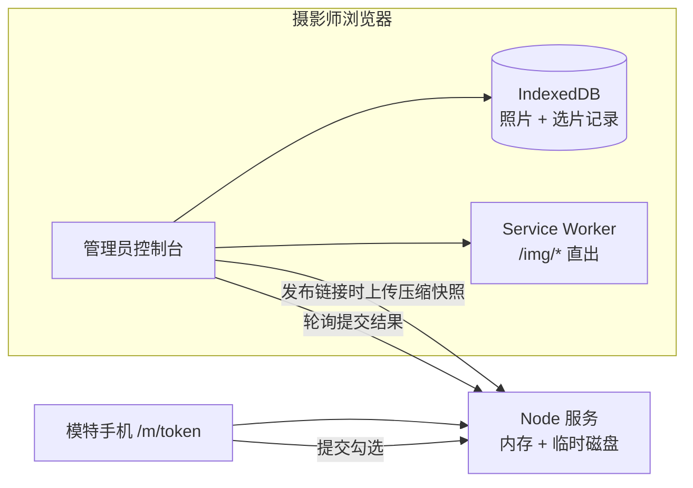

# 从零搭一个「摄影选片平台」

> 摄影师上传预览图 → 生成模特专属链接 → 模特在手机上打钩选片 → 摄影师一键导出文件名清单，配合网盘把没选中的 RAW 归档。

这是一个**可以照着做、也可以直接拿来用**的教学仓库：既有完整的可运行模板，也有把它拆开讲清楚的系列教程。

- 模板：`template/`（Node 20，零第三方依赖，`npm start` 就能跑）
- 教程：`docs/`（从产品拆解到部署上线，含真实踩坑记录）
- 线上示例：<https://pickphoto-studio.traesite.cn>
- 另一条技术路线（Cloudflare Workers + D1 原版）：<https://github.com/Pandaemonium-Lujiu/photoshoot-picker>

---

## 它能做什么

| 角色 | 入口 | 能力 |
|---|---|---|
| 摄影师（管理员） | `/` | 首次设置密码；建场次、拖拽上传（自动压缩）、勾选、暂存/确认、导出文件名、生成/管理模特链接、查看选片结果、复制 AI 整理提示词 |
| 模特 | `/m/<token>` | 只看这一场的照片；打钩选片；暂存/提交；有进度恢复 |

技术特征：

- 单进程 Node 服务，`server.js` 一个文件，零 npm 依赖
- 照片存浏览器 IndexedDB（刷新、关机都不丢），服务端只保存"已发布链接"的快照
- 管理员密码用 PBKDF2-SHA256 加盐哈希存在本机，不上传、不存明文
- 同时内置机甲终端（深紫 × 荧光绿）与 NERV（酒红 CRT）两套皮肤
- 手机端固定底栏、大图浏览、键盘快捷键（← → 空格 Esc）

## 架构一览



为什么这样分层、以及它和"全部放数据库"的区别，见 [docs/02-架构选型与数据模型.md](docs/02-架构选型与数据模型.md)。

## 本地跑起来（3 步）

```bash
cd template
npm start          # 默认 http://localhost:8000
```

1. 浏览器打开 `http://localhost:8000`，首次进入设置管理员密码（≥8 位）
2. 输入场次名（例如 `2026-11-26 人像`），把 JPG 拖进上传区
3. 勾选照片 → “生成新链接” → 把 `/m/<token>` 链接发给模特

不需要安装数据库，也不需要任何 API Key。

## 目录结构

```
template/
├── server.js              # HTTP 服务：静态页 + 分享快照接口
├── package.json
└── public/
    ├── index.html         # 管理员控制台（含两套皮肤）
    ├── model.html         # 模特选片页
    ├── auth.js            # 首次设密码 / 登录 / 修改密码（PBKDF2）
    ├── local-api.js       # 把 /api/* 映射到 IndexedDB + 分享快照
    ├── model-api.js       # 模特页接口适配
    └── sw.js              # Service Worker：图片从 IndexedDB 直出

docs/
├── 01-产品拆解与设计.md
├── 02-架构选型与数据模型.md
├── 03-管理员登录与密码哈希.md
├── 04-照片上传与本地库.md
├── 05-选片交互与分享链接.md
├── 06-部署上线.md
├── 07-踩坑与排查.md
└── 08-教学大纲.md
```

## 建议阅读顺序

1. 先跑一遍模板，感受完整流程（10 分钟）
2. [01 产品拆解](docs/01-产品拆解与设计.md)：想清楚角色、流程和验收标准
3. [02 架构选型](docs/02-架构选型与数据模型.md)：决定数据放哪，这是全项目最重要的决定
4. [03 登录](docs/03-管理员登录与密码哈希.md) → [04 上传](docs/04-照片上传与本地库.md) → [05 选片与分享](docs/05-选片交互与分享链接.md)
5. [06 部署](docs/06-部署上线.md) 上线给真实用户
6. 出问题时查 [07 踩坑与排查](docs/07-踩坑与排查.md)
7. 要开课/带人，直接用 [08 教学大纲](docs/08-教学大纲.md)

## 适合谁

- 会一点 HTML/JS，想做一个真实可用的小产品
- 摄影师的个人工作流自动化（选片、交付、归档）
- 想讲“从需求到上线”完整链路的老师/工作坊主

不需要会 React、不需要会数据库、不需要服务器运维经验；需要能读基础 JavaScript。

## 已知限制（先知道，少踩坑）

| 限制 | 说明 | 应对 |
|---|---|---|
| 服务端不持久 | 分享快照存在内存 + 临时磁盘，实例重启/重新部署会清空 | 重新生成链接；要长期稳定请用带数据库的方案 |
| 数据绑定浏览器 | 照片库在 IndexedDB，换设备/换域名看不到 | 换机器前先导出文件名清单；正式使用固定一个域名 |
| 密码不可找回 | 只存哈希，没有服务端账号体系 | 记牢密码；忘记只能清站点数据重设（照片仍在） |
| 单管理员 | 没有多用户/权限体系 | 需要团队协作时引入后端账号与数据库 |

想彻底解决持久化，可以走原版的 Cloudflare Workers + D1 路线，或把 `server.js` 的存储层换成任意数据库/对象存储。

## 模板怎么改成你自己的

- 改标题与文案：`template/public/index.html`、`model.html` 里的 `<h1>` 与 `title`
- 改配色：两个文件顶部的 CSS 变量（`--purple`、`--lime`、`--bg-canvas`…）
- 改分享有效期：`server.js` 里的 `SHARE_TTL_MS`
- 改单张大小上限：`server.js` 的 `MAX_IMAGE_BYTES` 与 `local-api.js` 的 900KB 判断
- 部署到其他平台：保持“单进程、监听 `PORT`、绑定 `0.0.0.0`”即可

## 许可与致谢

模板与教程来自作者自己的选片工作流实践。使用、修改、二次分发请保留出处链接。
