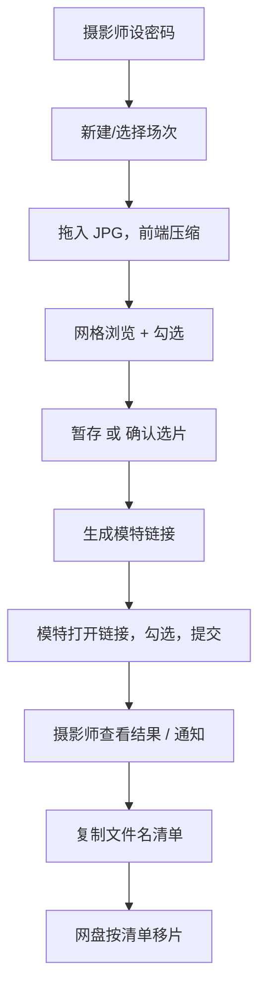

# 01 · 产品拆解与设计

> 目标：在写代码前，把"谁用、怎么用、什么算做完"写清楚。本文产出物是一份可以直接贴进 README 的需求清单 + 一份设计规范。

## 1. 一句话需求

摄影棚拍完一场，摄影师导出几百张 JPG 预览图，希望模特自己挑出留下的照片；摄影师拿到"文件名清单"后，去网盘把没选中的 RAW 原片挪进归档文件夹。

## 2. 角色与边界

| 角色 | 核心诉求 | 明确不做 |
|---|---|---|
| 摄影师 | 快速上传、勾选、导出清单、发给模特 | 不做修图、不做订单、不做 RAW 预览 |
| 模特 | 手机上流畅看图、打钩、提交 | 不能上传、不能看别的场次、不能看到原片 |

两个角色共用一个站点，靠**入口**区分：

- `/` 管理员控制台（需要密码）
- `/m/<token>` 模特选片页（token 即身份，一链接一场次）

## 3. 核心流程

关键判断：**选片结果以"文件名"为唯一标识**，不依赖图片 ID。因为摄影师最终要在网盘里按文件名找 RAW，图片在系统里的存储方式怎么变都不影响下游流程。

## 4. 页面与状态

### 管理员页

| 区域 | 内容 | 状态 |
|---|---|---|
| 顶栏 | 品牌、修改密码、退出、场次输入、状态徽标 | 选片中 / 未保存 / 已提交 |
| 概览 | 已选张数、模特链接、选片结果、暂存、确认、清空、删除场次 | — |
| 存储条 | 张数、场次数、配额进度 | 读取中 / 失败可重试 |
| 分享面板 | 生成链接（默认 30 天 / 可永久）、链接列表（复制、设永久、删除） | 空 / 有效 / 已失效 |
| 已选清单 | 序号 + 文件名 + 移除 | 空时隐藏 |
| 工具栏 | 全部 / 已选 / 未选、快速模式、每页 20/50/100、翻页 | — |
| 照片网格 | 缩略图、勾选按钮、放大按钮、文件名 | 空态文案 |
| 大图 | 上一张/下一张、文件名、序号、选这张 | 加载中 / 失败重试 |
| 弹窗 | 提交确认、选片结果、删除场次、同名照片、上传报告 | — |

### 模特页

比管理员页少了上传、分享、删除、统计；多了手机端固定底栏（已选数 + 暂存 + 提交）。其余筛选、分页、大图、快速模式一致。

## 5. 交互规则（容易被忽略但决定体验）

1. **快速模式**：开启时点照片 = 勾选；关闭时点照片 = 看大图，只有 `＋` 按钮才勾选。默认开启。
2. **暂存 vs 确认**：暂存是可反复覆盖的草稿；确认是最终提交，且"一张都没选"不允许确认。
3. **进度恢复**：模特再次打开同一链接，自动恢复上次勾选与状态。
4. **同名处理**：同一场次再传同名图片，弹窗选择"跳过 / 覆盖 / 取消"。
5. **删除场次**：二次点击确认（4 秒内），可选是否连同选片记录与链接一起清。
6. **通知**：模特确认后，管理员页右上角 15 秒内弹出卡片，点击直接跳到该场次结果。
7. **导出**：文件名去重、按自然序排序（`1.jpg` 在 `10.jpg` 前），一行一个。

## 6. 设计规范（机甲终端风）

这套视觉不是随便挑的颜色，而是"深色 HUD + 单一强调色"的约束系统。核心原则：

- 荧光绿**只**用于"选中 / 主行动 / 成功"，不能拿去做装饰
- 照片本身不加滤镜、不加蒙版，颜色只出现在 UI 上
- 装饰性 HUD 元素在手机端克制（窄屏隐藏）

| Token | UNIT-01（默认） | NERV（备选） | 用途 |
|---|---|---|---|
| `--bg-canvas` | `#0B0817` | `#0A0404` | 页面底色 |
| `--bg-surface` | `#141025` | `#1A0508` | 卡片 |
| `--bg-elevated` | `#1C1534` | `#120003` | 输入框、次级卡片 |
| `--stroke` | `#40315B` | `rgba(255,107,26,.28)` | 描边 |
| `--purple` | `#AE6BFF` | `#FF6B1A` | 主色 / 链接 / 标题 |
| `--lime` | `#B7FF45` | `#8DFF2D` | 选中 / 主按钮 |
| `--err` | `#FF6879` | `#FF4D4F` | 删除 / 错误 |
| `--tx` | `#F7F3FF` | `#FFE4C5` | 正文 |

布局规则：

- 面板用 `clip-path` 切一个 12–16px 的斜角，左上留一条 2px 主色标记
- 网格：手机 2 列 → 640px 3 列 → 900px 4 列 → 1400px 5 列
- 点击区域不小于 40×40px；手机端主按钮放固定底栏
- 切角、发光、扫描线都属于"皮肤"，通过 `html[data-skin]` 切换，不写在结构里

## 7. 验收标准（做完逐条打勾）

- [ ] 首次访问 `/` 要求设置密码；设置后刷新仍保持登录
- [ ] 密码错误有明确提示；修改密码后旧密码失效
- [ ] 上传 10 张 JPG，网格出现且顺序稳定
- [ ] 同名再传，能选择跳过或覆盖
- [ ] 勾选 3 张 → 暂存 → 刷新，勾选被恢复
- [ ] 确认选片后徽标显示"已提交"
- [ ] 生成链接 → 手机打开只看到本场照片
- [ ] 模特勾选并提交 → 管理页"选片结果"能看到
- [ ] 模特提交后 15 秒内管理页右上角出现通知
- [ ] 复制文件名清单，一行一个且无重复
- [ ] 删除场次后照片、记录、链接一起清空
- [ ] 手机宽度 375px 下无横向滚动，底栏可用

## 8. 接下来

需求清楚后，下一步是全项目最重要的决定：**照片和选片记录放在哪**。见 [02-架构选型与数据模型.md](02-架构选型与数据模型.md)。
