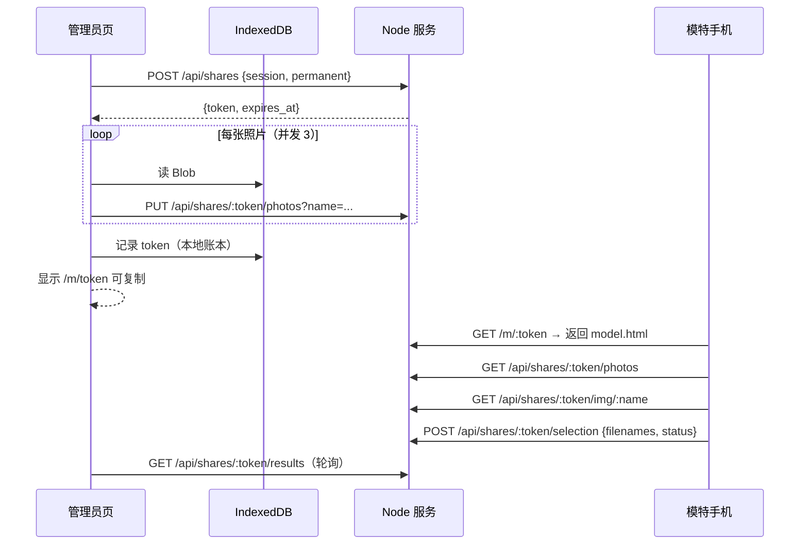

# 02 · 架构选型与数据模型

> 目标：回答一个问题——**照片和选片记录到底存在哪？** 这个决定会同时影响成本、隐私、可分享性和部署难度。

## 1. 三种可行方案

| 方案 | 数据在哪 | 跨设备分享 | 持久性 | 成本 | 适用 |
|---|---|---|---|---|---|
| A. 全后端（数据库 / 对象存储） | 服务端 | ✅ | ✅ | 需要数据库或 R2/S3 | 正式产品、多人长期使用 |
| B. 纯前端（IndexedDB） | 浏览器 | ❌ | ✅（本机） | 0 | 单机工具、离线演示 |
| C. 混合（本仓库） | 照片在浏览器；链接快照在服务端 | ✅（快照有效期内） | 本机永久，快照临时 | 0 | 个人工作流、短期交付、教学 |

原版（Cloudflare Workers + D1）是 A 方案；本仓库是 C 方案。两者 UI 几乎一致，只换数据层。

## 2. 为什么选 C

- 摄影师的照片本来就只需要自己看：放本机既省存储又天然隐私
- 模特只需要"这一场、这几百张"，发布时上传一份压缩快照即可
- 不需要注册账号、不需要数据库、不需要对象存储，部署门槛最低
- 代价：快照随实例重启/重新部署失效 → 重新生成链接即可；本机数据不受影响

判断标准：**如果链接必须在几个月后仍然可打开，选 A；如果链接是"这几天的交付"，选 C。**

## 3. 数据结构

### 3.1 浏览器端（IndexedDB，库名 `pick-local`，版本 1）

```text
photos      keyPath: key = "<场次>/<文件名>.jpg"
            { key, session, name, mime, size, blob, createdAt }
            index: session

selections  keyPath: session
            { session, filenames: string[], status: "draft" | "confirmed", updatedAt }

shares      keyPath: token
            { token, session, title, expiresAt, permanent, createdAt, url }
            index: session
```

要点：

- **图片以 Blob 存**，不是 base64。同样 200KB 的图，base64 会膨胀 33%，且解码更慢
- 选片记录以文件名数组保存，`status` 区分草稿/确认，覆盖式写入
- `shares` 是"我发过哪些链接"的本地账本，服务端丢了也能知道该重新发哪几条

### 3.2 服务端（内存 Map + 临时目录）

```js
shares: Map<token, {
  token, session, title,
  expiresAt,          // null = 永久
  createdAt,
  photos: Map<name, { mime, buf }>,
  selection: { filenames, status, updatedAt } | null
}>
```

落盘位置：`${TMPDIR:-/tmp}/photoshoot-picker-store/shares/<token>/`
- `meta.json`：元信息 + 照片名列表 + 选片记录
- `<encodeURIComponent(文件名)>`：图片二进制

启动时 `loadStore()` 尝试恢复。**这只是"同一实例重启尽量不丢"，不是持久化承诺**。

## 4. 接口设计

管理员页沿用原站的 `/api/*` 路径，由 `local-api.js` 在浏览器里拦截；只有"发布链接"才真正打到服务端。

| 方法 | 路径 | 处理方 | 作用 |
|---|---|---|---|
| GET | `/api/sessions` | 本地 | 场次列表 |
| GET | `/api/photos?session=` | 本地 | 该场次照片 key |
| GET | `/img/<key>` | Service Worker | 从 IndexedDB 出图 |
| PUT | `/api/upload?obj=<key>` | 本地 | 写入照片 Blob |
| GET/POST | `/api/selection` | 本地 | 读取/保存管理员自己的勾选 |
| GET | `/api/stats[?session=]` | 本地 | 张数、字节、配额 |
| POST | `/api/sessions/delete` | 本地 | 删除场次（可连带清链接） |
| POST | `/api/password` | 本地 | 校验旧密码并写入新哈希 |
| GET | `/api/shares?session=` | 本地 + 探测服务端 | 链接列表与有效性 |
| POST | `/api/shares` | 本地 → 服务端 | 创建链接并逐张上传快照 |
| POST | `/api/shares/permanent` `/delete` | 本地 → 服务端 | 设永久 / 删除 |
| GET | `/api/selections?session=` | 本地 + 服务端 | 合并管理员与模特的提交 |
| GET | `/api/notifications?since=` | 本地 + 服务端 | 模特新提交通知 |
| POST | `/api/shares/:token/photos?name=` | 服务端 | 上传一张快照（≤1MB） |
| GET | `/api/shares/:token/photos` | 服务端 | 模特端照片 key 列表 |
| GET | `/api/shares/:token/img/:name` | 服务端 | 模特端图片 |
| GET/POST | `/api/shares/:token/selection` | 服务端 | 模特读取/提交勾选 |
| GET | `/api/shares/:token/results` | 服务端 | 管理端查看该链接提交 |
| GET | `/api/health` | 服务端 | 健康检查 |

## 5. 发布链接的完整时序



失败处理：任何一张上传失败 → 删除刚创建的服务端链接 → 给用户明确错误，不留下"半条链接"。

## 6. 安全边界

- 管理员密码只在本机校验（PBKDF2 哈希存 localStorage），服务端没有管理员概念
- 链接 token 是 128 位随机十六进制，等于访问凭据；不要发到公开群
- 服务端按 token 隔离：`/api/shares/:token/*` 只能访问该链接自己的照片与记录
- 所有写接口校验 `Origin`，防简单的跨站提交
- `HttpOnly` Cookie 方案不适用于纯本地密码，别照搬原站

## 7. 什么时候该升级架构

出现下面任意一条，说明 C 方案到头了：

- 链接需要在数周/数月后仍然可用
- 摄影师换电脑仍要继续管理同一批场次
- 需要多管理员、客户账号、操作审计
- 照片需要长期保存且总量超过浏览器配额

升级路径：把 `local-api.js` 里的本地函数逐个替换成 HTTP 接口，服务端把 `Map` 换成 SQLite/Postgres + 对象存储。UI 一行不用改。
